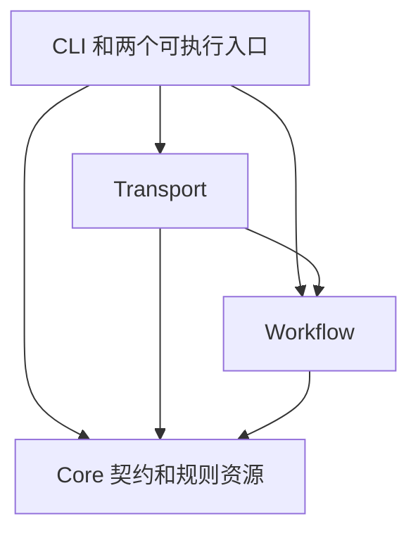

# 工作流架构

本文档区分新增的 **Pi 宿主侧有状态流程引擎** 与既有 **MCP 无状态规则/工作流服务**。两者都不取代 Markdown owner 的策略权威，也不决定授权。

## Pi 宿主侧 Extension 与 Hooks

入口为 `extensions/coding-workflow/index.ts`。`catalog.ts` 绑定既有 Layer-04 模块与检查点形状；`engine.ts` 维护七模块顺序、当前位置、模式/预算、Slice、三维 epoch、修复与恢复回环；`runtime.ts` 将真实 Pi 事件接到状态机及条件 Hook 包，工具调用仍经实际 `ctx.executeTool` 的宿主校验/权限链。

Extension 状态使用实际 Pi Session 的 custom entry，不是 Memory 后端、服务端数据库或原子事务。按当前对话分支恢复位置，同时保留整个 Session 已绑定的子任务名额；树导航不会回退磁盘效果。每次模型请求只注入当前模块和相关 [Hook 合同](hooks/README.md)，而非预加载整个 Skill；源码/规则 Hash 变化要求重新核验。

可观察事件自动处理；需求变化、独立性、修复范围、文档影响等语义判断由 Agent 通过结构化信号报告。顺序、字段、引用、预算、路径和 epoch 可以守卫，授权、事实真实性、验证充分性和语义验收仍须独立判断。该扩展不是 OS 沙箱，也不自动证明不透明命令的副作用分类。

[使用与限制](PI_EXTENSION.md)说明安装、一次性子代理适配、有限续跑、离线测试与未验收事项。旧 Skill-only CLI 不安装此 Extension。

当前指令已面向 Pi Coding Agent 改写，但 MCP Server、调用方身份、注册表和服务端结构校验尚未同步迁移。以下是既有实现的边界说明，不构成 Pi 接入完成证明。指令侧 `scripts/check-layer-01-sections.py` 独立检查“通用规范 → Pi Coding Agent 优化指令 → 相关概念”；它不改变服务端校验契约，不能据此声称候选预检、片段提取或打包安装已经兼容新结构。尚未验证的服务功能不得默认调用；依据直接 owner 执行获准路径，或在必需能力缺失处暂停。

## MCP 工作流与规则

工作流 server 提供对当前规则上下文的有界访问、规则导航，以及对调用方所供事实的结构检查。规则文档仍具权威性。工具结果、Hash 和调用方声明不能认证调用方、证明权限或来源、判定语义真实性、通过检查点、建立跨调用顺序或验收工作。调用方必须阅读当前 owner、独立解释证据，并在对话上下文中保留父级控制任务记录。

无状态规则与工作流路径无需 SQLite 数据库、API 凭据或网络请求。可选语义建议可以依据开发指南中的独立 API 授权和凭据规则，发送显式配置的 API 请求；其结果仍仅供建议，不能授权工作。两个独立 MCP 可执行程序继续保留；其支持的客户端及工具清单见[MCP 开发指南](../../mcp/DEVELOPMENT.md)。

## 受保护的输出物化

可选输出物化操作独立于工作流评估。它需要由可信启动配置注入的授权 provider，提供当前 Worker 绑定和 assignment 上下文；另须提供独立 grant 并通过既有的逐次调用检查。工具调用方不能选择或提供该 provider 上下文。当前没有标准 provider；未显式配置可信 provider 和 grant 时，此能力不可用。应用请求范围不等于宿主认证。[输出物化](references/coding/layer-01-fundamental-concepts/execution-planning/output-materialization.md) owner 仍负责准备、全新预检、manifest 检查和写入时重新授权。

## 实现包

MCP workspace 包含独立构建的 `core`、`transport` 和 `workflow` 分发包。Core 负责稳定契约、清单、规则和打包资源；transport 负责 MCP 注册、请求范围和 schema；workflow 负责规则查找、无状态评估、导航/建议及可选物化服务。根分发包提供两个 MCP 可执行程序及管理 setup。[开发指南](../../mcp/DEVELOPMENT.md)负责当前工具数量、包命令、构建和验证流程。

## API 与数据边界

每个可选 OpenAI API 请求都必须使用开发指南指定的必需进程环境值和固定模型。配置缺失时必须在发出请求前失败。MCP 的无状态工作流工具不持久化 Session 状态，也不执行 Git、文件、Agent 创建或派发操作；不要与上面的宿主侧协调器混同。输出物化是范围明确的例外；缺少可信启动配置时仍不可用。

规则注册表和片段索引是与当前 Markdown owner 绑定的导航数据。源码和打包资源必须来自同一来源、同一语言。上下文 Hash 仅标识返回文本，不证明任务事实或授权。结构评估只检查声明的输入结构和规则兼容性，返回的审阅状态仍须由 Agent 对照 owner 和证据解释。

## 相关概念

- [工作流规则上下文](references/coding/layer-01-fundamental-concepts/workflow-navigation/rule-context.md) — 有界查找和所供事实结构检查。
- [工作流导航可用性](references/coding/layer-01-fundamental-concepts/workflow-navigation/navigation-availability.md) — 直接读取 owner 的回退和不可用处置。
- [Coding Delegation State Record](references/coding/layer-01-fundamental-concepts/delegation/delegation-state-record.md) — 父级控制任务记录。
- [Output Materialization](references/coding/layer-01-fundamental-concepts/execution-planning/output-materialization.md) — 独立守卫的输出写入。
- [Coding 工作流选择器](workflows/coding.md) — 路线导航。
