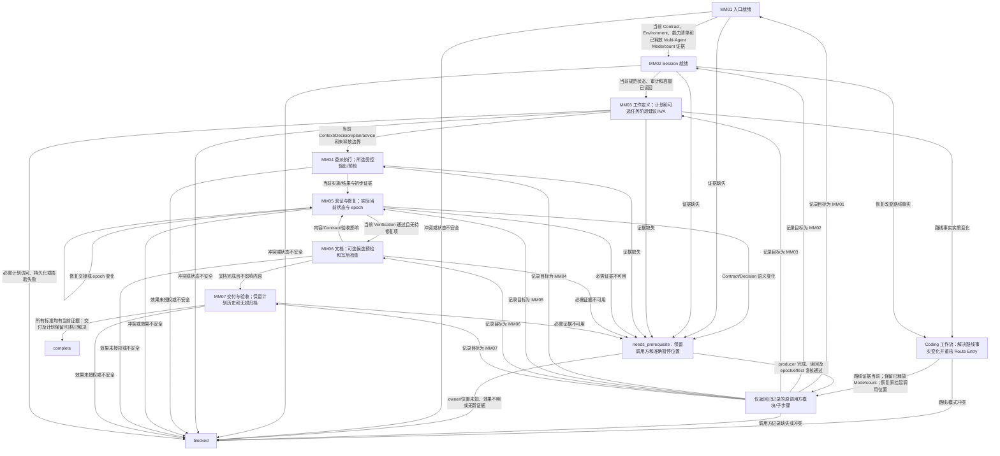

# Coding 工作流 — Multi-Agent 模式

<!-- 由 docs/rules/coding-workflows/coding-multi-agent.yaml 生成。请在 DSL 中维护正文。 -->

本路线按序绑定 Multi-Agent Coding 的七个阶段 Hook，使用已释放模式及锁定的正数 child count。路线安排阶段入口，在前置缺失时保留调用方位置，并将状态变化返回受影响的阶段。

子代理来自当前真实扩展，而非宿主内置能力。独立且不冲突的已放行切片可以并行；依赖性工作保持顺序。同步一次性扩展可以在一次调用中创建、派发并返回，在 DE07 消费结果；不模拟持久 ID、send/wait/resume。仅复用真实支持续接的身份。保留批准预算、职责唯一、完整结果审阅及独立验证要求；不能因工具方便而扩容。

## 工作流路线图

## 路线顺序检查清单

进入 MM01 前，检查 Coding 工作流已完成 Contract、Environment、能力清单、Mode 和 Route Entry 的证据。不得重复这些门禁。本路线要求正数锁定 child count；预留数量本身不授权创建子代理。每一步只调用所链接的模块；前置导致暂停时，保留准确模块检查点和已完成效果，并从返回位置恢复。不得重放先前效果，也不得因缺少前置而重启整条路线。

1. **MM01 — 入口就绪。** 调用[入口就绪 Hook](../hooks/entry.md)。传入 selector 已释放的 Contract、Environment、能力、Mode 和路线证据。入口核验通过后进入 Session，补前置时保留原位置。
2. **MM02 — Session 就绪。** 调用[Session 就绪 Hook](../hooks/session.md)。在消费审计结果前完成规范 Session 读回。Multi-Agent 另核对锁定容量。恢复时保留已锁定的模式与已确认的启动答案。
3. **MM03 — 工作定义。** 调用[工作定义 Hook](../hooks/planning.md)。取得当前 Context、Decision、未释放边界和计划证据后才进入执行。缺失或过期时回对应 owner，授权或路线事实实质变化时交调用方重核。
4. **MM04 — 委派执行。** 调用[委派执行 Hook](../hooks/delegation.md)。带入锁定数量、当前计划、前序证据和已有效果。保留原调用位置、Worker bundle 和已完成的派发效果。实施或真实 Worker 结果和初步检查齐备后交验证。
5. **MM05 — 验证与修复。** 调用[验证与修复 Hook](../hooks/verification.md)。对实际当前状态和适用 epoch 验证。必需独立验证或修复未解决时暂停依赖效果。修复回本阶段重验，Contract 或 Decision 的实质变化交调用方。
6. **MM06 — 文档。** 调用[文档 Hook](../hooks/documentation.md)。传入当前验证、Contract 和写前指纹。仅在当前文档结果齐备时进入交付。内容、Contract 或验收变化时返回 MM05，验证通过后恢复挂起的 MM06 子步骤。
7. **MM07 — 交付与验收。** 调用[交付与验收 Hook](../hooks/delivery.md)。根据当前标准、Verification 和准确的已授权交付目标验收。每项适用标准及所请求的效果均解决后方可完成；计划归档复用此 Hook 的全文保全检查。

## 前置返回映射

仅在其 producer/recheck 位置补齐缺失项。保留原挂起模块/子步骤、已完成效果和相关 epoch；若 producer 也暂停，则在现有调用方上下文保留嵌套 continuation。读回结果并重核 epoch/effect 后，只恢复原调用方位置。Contract/Environment/Mode 证据缺口仅需补齐缺失证据；只有路线事实实质变化时才重核 Route Entry，然后在保留锁定 Mode/count 的情况下返回原挂起位置。不得重放前序效果或重开已释放 Mode/count。owner/位置/效果未知、无进展或效果不可恢复时阻塞依赖工作。

| 缺失前置 | producer/recheck 位置 | 读回后恢复位置 |
| --- | --- | --- |
| Contract/验收标准 | Coding 工作流 Contract owner；仅补齐缺失证据。 | 原挂起 MM 模块/子步骤；只有路线事实实质变化时才重核 Route Entry。 |
| Environment/能力清单 | 对应 Environment/能力 owner；仅补齐缺失证据。 | 原挂起 MM 模块/子步骤；只有路线事实实质变化时才重核 Route Entry。 |
| Route Entry 证据或已变化的路线事实 | 仅对实质变化事实调用 Route Entry owner；保留已释放 Mode/count。 | 路线仍有效时恢复原挂起 MM 模块/子步骤；否则阻塞。 |
| 已释放 Multi-Agent Mode/count 证据 | 使用既有 Mode owner 和锁定记录读回；不得重复已释放选择。 | 仅在当前 Multi-Agent mode 和正数数量得到确认后恢复原挂起位置；冲突时阻塞。 |
| Session state、authority、审计或容量 | MM02 Session owners；复用审计/容量前先完成 canonical state 读回。 | 读回后恢复原挂起 MM 模块/子步骤；若调用方本身是 MM02，则恢复其记录的 producer 子步骤。 |
| Context、Decision、plan 或 advice | MM03 WD owners；只解决缺失子步骤。 | 原挂起 MM 模块/子步骤；例如 MM07 在 WD 证据读回后仍恢复 MM07。 |
| Bootstrap、任务授权、执行者/输出、角色、Slice 或 Control | MM04 DE01–DE08 owners；不得重放已完成的分配/派发效果。 | 结果读回并核对 effect/epoch 后恢复原挂起位置。 |
| Verification、修复诊断或 handoff | MM05 VR owners；保留当前维度和修复效果。 | 当前证据完成后恢复原挂起位置；MM06 在验证返回后恢复其挂起 DOC 子步骤。 |
| 文档影响、owner 要求的 Memory 内容核验或检查 | MM06 DOC owners；VR 返回后完成挂起的 DOC 子步骤。 | 读回、影响分类及检查完成后恢复原挂起位置。 |
| Git target/effect、Acceptance 标准或计划归档 | MM07 DA owners；仅在全部标准通过并完成所需读回后归档。 | producer 证据读回后恢复原挂起 MM 模块/子步骤。 |

## Mode 边界

只使用已释放的 Multi-Agent mode 和正数锁定数量。角色分配、创建、派发、复用、memo 和子代理生命周期由所调用模块组合的底层 owners 管理；本路线只负责模块顺序。

## 相关概念

- [入口 Hook](../hooks/entry.md)
- [委派 Hook](../hooks/delegation.md)
- [验证 Hook](../hooks/verification.md)
