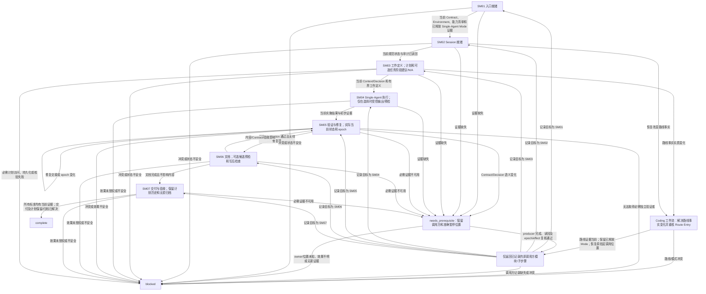

# Coding 工作流 — Single-Agent 模式

<!-- 由 docs/rules/coding-workflows/coding-single-agent.yaml 生成。请在 DSL 中维护正文。 -->

本路线按序绑定 Single-Agent Coding 的七个阶段 Hook。路线安排阶段入口，在前置缺失时保留调用方位置，并将状态变化返回受影响的阶段。

所有决策、实现和检查留在当前 Pi 会话，用实际 read/edit/write/bash 及获准的工具完成，不创建子代理或为规划启动额外会话。可选导航/结构检查不适用时直接读取 owner；必需能力缺失才暂停依赖分支。机械步骤在同一已放行 Slice 内批量推进，不增加逐命令检查点。

## 工作流路线图

## 路线顺序检查清单

进入 SM01 前，检查 Coding 工作流已完成 Contract、Environment、能力清单、Mode 和 Route Entry 的证据。不得重复这些门禁。本路线仅适用于已释放的 Single-Agent Coding，且始终留在当前 Session。每一步只调用所链接的模块；前置导致暂停时，保留准确模块检查点和已完成效果，并从返回位置恢复。不得重放先前效果，也不得因缺少前置而重启整条路线。

1. **SM01 — 入口就绪。** 调用[入口就绪 Hook](../hooks/entry.md)。传入 selector 已释放的 Contract、Environment、能力、Mode 和路线证据。入口核验通过后进入 Session，补前置时保留原位置。
2. **SM02 — Session 就绪。** 调用[Session 就绪 Hook](../hooks/session.md)。在消费审计结果前完成规范 Session 读回。Multi-Agent 另核对锁定容量。恢复时保留已锁定的模式与已确认的启动答案。
3. **SM03 — 工作定义。** 调用[工作定义 Hook](../hooks/planning.md)。取得当前 Context、Decision、未释放边界和计划证据后才进入执行。缺失或过期时回对应 owner，授权或路线事实实质变化时交调用方重核。
4. **SM04 — Single-Agent 执行。** 调用[Single-Agent 执行 Hook](../hooks/execution.md)。继续锁定的 Single-Agent 路线，带入当前计划、前序证据和已有效果。保留 Control 和下一 Slice 的继续位置。实际实施及初步检查齐备后交验证。
5. **SM05 — 验证与修复。** 调用[验证与修复 Hook](../hooks/verification.md)。对实际当前状态和适用 epoch 验证。必需独立验证或修复未解决时暂停依赖效果。修复回本阶段重验，Contract 或 Decision 的实质变化交调用方。
6. **SM06 — 文档。** 调用[文档 Hook](../hooks/documentation.md)。传入当前验证、Contract 和写前指纹。仅在当前文档结果齐备时进入交付。内容、Contract 或验收变化时返回 SM05，验证通过后恢复挂起的 SM06 子步骤。
7. **SM07 — 交付与验收。** 调用[交付与验收 Hook](../hooks/delivery.md)。根据当前标准、Verification 和准确的已授权交付目标验收。每项适用标准及所请求的效果均解决后方可完成；计划归档复用此 Hook 的全文保全检查。

## 前置返回映射

仅在其 producer/recheck 位置补齐缺失项。把原调用方模块/子步骤及其已完成效果保留为 continuation 栈项；若补前置本身又暂停，也保留 producer continuation。producer 完成后读回证据并重核相关 epoch/效果，然后仅恢复原调用方位置，不得恢复到 producer 位置或顺跑下一模块。不得重放效果、重开已释放 Mode 或重复已完成提问。Contract/Environment/Mode 证据缺口只在现有 owner 读取/补齐；仅路线事实实质变化时重进 Route Entry，然后保留锁定 Mode 返回原调用方。producer/位置/效果未知或循环未产生新证据时，阻塞依赖工作。

| 缺失前置 | producer/recheck 位置 | 读回后恢复 |
| --- | --- |
| Contract 或验收范围 | Coding 工作流 Contract 检查点；仅补齐缺失证据。 | 原挂起模块/子步骤，例如 SM07；不得从 SM01 重跑。 |
| Environment/能力清单 | Environment 和能力清单 owners；仅读取/补齐缺失清单。 | 原挂起模块/子步骤；仅当路线事实实质变化才重核 Route Entry。 |
| Route Entry 证据或路线事实实质变化 | 仅路线事实变化时由 Route Entry owner 复核；不重复锁定 Mode。 | 同一路线仍有效则恢复原挂起模块/子步骤；否则阻塞失效路线。 |
| 已释放 Mode 证据缺失或不一致 | 既有 Mode owner 和锁定记录读回；不得再次询问已释放选择。 | Single-Agent 证据当前后恢复原挂起模块/子步骤；冲突时阻塞。 |
| Session state、authority 或审计 | SM02 的 SR02/SR03 及其返回的具体 Session/state/audit owner。 | Session 证据读回后恢复原挂起模块/子步骤；若 SM02 本身是调用方，则恢复其挂起的 producer 子步骤。 |
| Context、Decision、规划输出或 advice | SM03 的 WD01–WD03 及具体 Context/Decision/planning/advice owner。 | 证据当前后恢复原挂起模块/子步骤；例如 SM07 调用方补 Context 后回 SM07，不转到 SM03。 |
| 执行者/输出、Slice、反馈或 Control | SM04 的 SE01–SE05 及责任 owner。 | 恢复原挂起模块/子步骤；例如 SM07 调用方补齐前置后回 SM07，不转到 SM04。 |
| Verification、修复诊断或 handoff | SM05 的 VR01–VR05 及责任 owner。 | 当前证据/handoff 完成后恢复原挂起模块/子步骤；SM06 在验证返回后恢复挂起 DOC 子步骤。 |
| 文档影响、owner 要求的 Memory 内容核验或必需检查 | SM06 的 DOC01–DOC06 及具体 Documentation/Memory/check owner。 | 恢复原挂起模块/子步骤，包括验证返回后的 DOC 子步骤。 |
| Git target/effect 或 Acceptance 标准/归档 | SM07 的 DA02–DA05 及 Git/Acceptance/plan owner。 | producer 证据读回后恢复原挂起 DA 子步骤。 |

## Mode 边界

所有阶段均留在当前 Session；绝不创建其他 Session。将 Input-side Reasoning、Primary Output 和验证视为同一 Session 内的逻辑阶段。只有适用 Verification owner 通过当前证据确认要求已满足时，才可声称独立验证；必需的独立性不可用时，阻塞依赖效果。

## 相关概念

- [入口 Hook](../hooks/entry.md)
- [执行 Hook](../hooks/execution.md)
- [验证 Hook](../hooks/verification.md)
