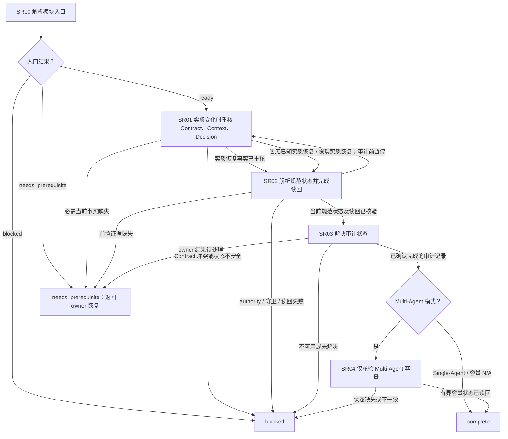

# Session Hook 合同

<!-- 由 docs/rules/hooks/session.yaml 生成。请在 DSL 中维护正文。 -->

## 触发条件

当首次收到 Coding 指令、进入任何依赖当前 Session 身份/模式/数量/分配的工作、恢复或 compact 后继续、出现真正新根/Fork、需更新父级控制记录，或准备使用 Worker/子代理时触发。它覆盖完整宿主 Session 生命周期，不是逐轮重选。普通后续轮次沿用已锁定状态；真正新身份的 Fork 必须重新经过模式与数量门禁。Pi 的主会话、扩展子任务、持久子代理身份不是天然一一对应；不得从工作目录、名称或一次调用推断身份或 worktree 隔离。

输入至少包括用户当前指令及明确模式/数量偏好、当前 Session 身份证据、现存规范父级对话记录、已释放路线和任务 Contract。记录尚不存在不构成入口失败，应按首次选择建档；但依赖状态的受保护操作不能在模式/身份/记录证据缺失或冲突时继续。

## 执行要求

### 1. 选择并锁定模式

根父级在首次 Coding 启动按固定顺序收集：先 single/multi 与预算，后审计可见性。扩展仅由用户 `/coding start <任务>`、single/multi 快捷命令或显式 flag 启动，共用 `startup.ts` 单一问题注册表。模式菜单提供 Multi（预算1）、Single、自定义 Multi 正整数；显式模式/数量不重问，multi 省略数量沿用已确认预算或默认1，无效/取消不回退。审计菜单支持使用默认或定制缺失字段，逐字段记录 explicit/default；显式有效字段不重复问。未回复、取消或无效答案不隐式默认，答案未齐不创建 Workflow、不执行工具。非 UI 必须显式提交答案或清晰阻断，不伪造用户选择。同一 Session 已确认答案跨完成后新任务、树导航、reload/resume 保留，不重问、不回收预算；fork/new Session 重新收集。volatile 不 appendEntry，只保留当前进程状态，丢失后不能依赖日志声称可恢复。启动并发串行拒绝，取消或 Session/树导航使迟到答案失效。

单代理的预算为 0，已选择 Multi 且省略数量时初始预算为 1。Root 用真实启动指令或用户答复保留模式/数量来源。扩展快照记录 `mode`、`childCount` 和各审计字段来源。名额用尽且确需不同职责时，由用户按数量门禁显式执行 `/coding add-slot <完整职责名>` 增加一个名额。该命令仅更新容量；Root 仍须另行核验职责和 Slice。

### 2. 维护规范状态

通过 `coding_checkpoint status` 回读实际 Session 记录，核对 `mode`、`childCount`、`allocations`、`slice`、`audit`、检查点和已知未决效果。空闲容量由预算与占用数之差表示。扩展在进入实际委派时登记 allocation，未使用的容量没有对应占位对象。Root 保留实际指令、批准来源、日志访问证据和其他宿主字段未承载的事实。使用状态记录 owner 的语义条件核验；其手动模板用于未启用扩展的回退路线。

按 [Session 职责 owner](../references/coding/layer-01-fundamental-concepts/session-runtime/session-role-ownership.md) 检查唯一职责和能力。Root 负责前置决策、放行、用户交互与最终验收。已启动的任务即使失败、中断或终止也占用名额和职责；只有宿主确认实际未执行才可撤销未绑定的预留。一次性任务的逻辑 allocation 用真实调用定位。Scope、影响、返回条件和显式 `write_content_memo` 随实际派发内容传递，缺少可靠承载方式时暂停依赖派发。

### 3. Pi 能力边界

以当前会话明确宿主元数据和实际暴露能力为准，不从模型名、工具名或 Shell 推断。工具可用不等于授权；模式获批不等于扩展存在。若当前有 codemode，先 `searchTools`/`describeTool` 核对实际工具 Schema，再按需读取 namespace 服务指令；hidden 不绕过。只有真实暴露且授权的子代理能力才可使用，按 Schema 核验范围、目录、权限、返回/取消、持久身份续接支持；仅传真实接受字段。不伪造 ID、调用结果、effort、消息或能力。Pi 不默认提供内置子代理或 Plan mode，不从 Shell 启动另一个 Pi 来补造。一次性任务以真实调用证据绑定逻辑 allocation，不声称可恢复；缺持久身份仅限制依赖复用的分支。Session 隔离不等于 worktree 隔离。禁止 Computer Use 及经 Shell/MCP/子代理包装的同类操作。

输入输出：输入是当前身份、用户选择、规范记录和扩展能力证据；输出是已读回的规范记录、锁定路线/容量、逐项证据与未满足前置。Session readiness 可返回 complete、needs_prerequisite、blocked；审计及容量核验不授权子代理工作。

## 工作流路线图

## 有序模块清单

1. **SR00 — 解析入口。** 带入入口阶段的已释放路线/模式、当前任务范围、Session 身份/角色、路径、epoch 和 continuation/效果证据。规范记录由本阶段建立。按入口合同核验，在证据不足时记录所缺 owner 和原暂停子步骤，冲突或无法安全恢复时阻断。

   依据 [模块入口解析](../references/coding/layer-03-workflow-checkpoints/module-entry-resolution.md)。
2. **SR01 — 复核实质变化。** 若当前 Contract、Context 或 Decision 发生实质变化，在依赖它们前审阅当前直接证据。不得重做规划、请求建议、重开 Mode 或启动下游效果。无实质变化时，记录有原因的 `not_applicable`。事实缺失时返回 `needs_prerequisite`；冲突或不安全事实返回 `blocked`。
3. **SR02 — 核验规范 parent-context 记录。** 回读已释放的 mode/count、当前真实身份和角色、逐操作权限、规范 Session 记录及适用的 allocation。结构结果和应用范围不代替身份或授权证据。证据缺失返回 `needs_prerequisite`；冲突或必需 owner 不可用返回 `blocked`。

   依据 [Session 状态解决](../references/coding/layer-03-workflow-checkpoints/session-state-resolution.md)。
4. **SR03 — 应用审计偏好。** 用实际生效的审计配置、每字段 explicit/default 来源和必要的日志访问证据作为结果。启动答案缺失则回到模式/预算 → 审计收集，保留已确认字段。fork/new Session 重新确认。仅在依赖的必需日志证据不可用或未验证时阻断。

   依据 [Session 审计解决](../references/coding/layer-03-workflow-checkpoints/session-audit-resolution.md)、[Session Audit Visibility](../references/coding/layer-01-fundamental-concepts/session-runtime/session-audit-visibility.md)、[Reasoning Summary Visibility](../references/coding/layer-01-fundamental-concepts/session-runtime/reasoning-summary-visibility.md)、[委派状态记录](../references/coding/layer-01-fundamental-concepts/delegation/delegation-state-record.md)。
5. **SR04 — 仅在 Multi-Agent 适用时核验容量。** 在已放行 Multi-Agent 模式下，读取当前父级控制分配。应用[委派数量门禁](../references/coding/layer-01-fundamental-concepts/delegation/delegation-mode-count-gate.md)、[委派状态记录](../references/coding/layer-01-fundamental-concepts/delegation/delegation-state-record.md)，并按条件应用[子代理职责分配](../references/coding/layer-01-fundamental-concepts/delegation/delegation-child-role-allocation.md)，核实锁定容量、已占用角色和未分配名额。这只是只读核验：不得选择/预留角色、释放 Slice、创建子代理或回收名额。Single-Agent 模式记录附有理由的 `not_applicable`。返回 `complete`，并附上当前父级记录读回、生效的审计偏好和适用的容量证据；这些证据均不授权子代理任务。

## 退出与阻断

模式和数量有效、状态完整一致、当前身份/角色及必需权限可核实后，才能退出为可供后续 owner 消费的就绪状态。awaiting-mode/count、未解决选择、记录缺失/冲突、身份/角色证据不明、Schema 不支持必需字段、能力/权限拒绝或状态不安全时，阻断依赖该事实的操作并记录暂停点及原因。能力不可用只阻断依赖分支；有独立授权且不依赖该事实的工作可继续。单代理路线禁止创建、fork、handoff、联系、替换或管理其他 Agent/Session；独立验证仍是语义要求，但该路线不能提供独立性。不得把工具存在、菜单选择、容量记录或审计完成声称为创建授权。

## 重新核验

在每次路线放行/受保护操作前回读规范状态；分配、Slice、生命周期、用户批准、身份、权限、扩展工具清单/Schema、Contract 或相关事实变化后，只重新核验受影响项。compact/同会话恢复保留状态；身份为新根的 Fork 从本会话当前指令重新选择模式/数量、建新记录，不导入来源身份、预算或选择。核验结果绑定当前 Session 身份、角色、记录回读、分配及相关 epoch；消费前再读父级记录。恢复不清楚时先查证，不能从文件名猜测。

## 规则来源

| 来源 | 本合同落点 |
| --- | --- |
| [Session模型](../references/coding/layer-01-fundamental-concepts/session-runtime/session-model.md) | 生命周期、Fork、拓扑、Primary affinity与一次性任务 |
| [Session职责](../references/coding/layer-01-fundamental-concepts/session-runtime/session-role-ownership.md) | Root责任及四种子职责边界 |
| [委派状态记录](../references/coding/layer-01-fundamental-concepts/delegation/delegation-state-record.md) | 规范字段、状态、名额与唯一性 |
| [模式确认](../references/coding/layer-01-fundamental-concepts/delegation/delegation-mode-confirmation.md) | 扩展与回退入口、默认值和选择来源 |
| [数量门禁](../references/coding/layer-01-fundamental-concepts/delegation/delegation-mode-count-gate.md) | 正整数、无效数量、不同职责的明确加一批准 |
| [模式重入](../references/coding/layer-01-fundamental-concepts/delegation/delegation-mode-reentry.md) | Session锁定、Fork新身份与重入 |
| [Pi运行时](../references/coding/layer-01-fundamental-concepts/session-runtime/runtime-provider-support.md) | Schema、能力/授权分离及适配缺口 |
| [状态解析](../references/coding/layer-03-workflow-checkpoints/session-state-resolution.md) | 当前父级记录、身份与读回 |
